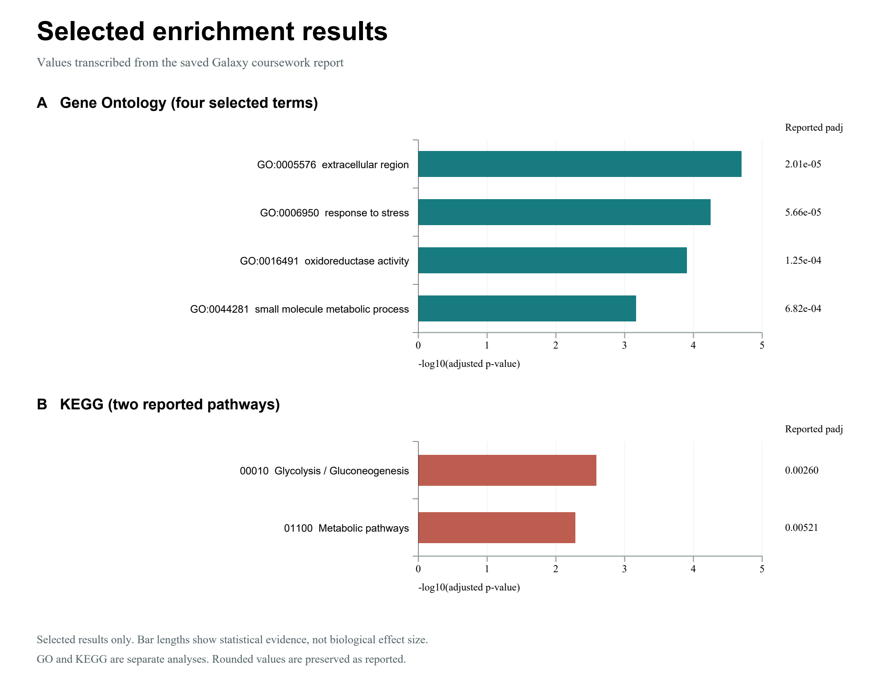

# Computational Bioinformatics: RNA-seq and Phylogeny

I completed two bioinformatics coursework exercises: a reference-based RNA-seq analysis in Galaxy and a plant GPX1 phylogeny exercise in MEGA12. I put the methods, selected results, and original tree figures here so that the work can be read alongside its limitations.

My main learning was that biological interpretation depends on getting the sample metadata and data provenance right. A missing treatment tag stopped DESeq2, while incomplete labels made some tree interpretations unreliable. Both were worth investigating carefully.

**Start here:** [Portfolio report (PDF)](report/computational-bioinformatics-portfolio.pdf) | [Methods and results](rnaseq/README.md) | [Phylogenetic figures](phylogeny/methods-and-results.md) | [Evidence notes](PROVENANCE.md)

## Case Studies

| Case study | Question | Work preserved here |
|---|---|---|
| [Reference-based RNA-seq](rnaseq/) | How does Pasilla depletion affect gene expression in Drosophila? | Seven-sample design, DESeq2 troubleshooting, selected GO/KEGG results, and a GTN workflow |
| [Plant GPX1 phylogeny](phylogeny/) | How do NJ and ML represent relationships among the sampled proteins? | Four original tree figures, method notes, bootstrap interpretation, and an audit of missing labels |

These are separate coursework studies. They share an emphasis on computational analysis and critical interpretation; I did not combine them into one biological experiment or train a machine-learning model.

## Selected RNA-seq Results

This figure was rebuilt from rounded values in my saved report. The selected terms concern extracellular components, stress response, oxidoreductase activity, and metabolism. The [CSV](rnaseq/results/enrichment-summary.csv) records the values. Enrichment does not establish pathway activation or causality.

## What I Did and Learned

- Organized seven count files into treatment and sequencing-layout groups, with four untreated and three treated samples.
- Diagnosed an upstream filename-parsing error, corrected a three-group expression to handle four identifier components, and restored the treatment tags needed by DESeq2.
- Interpreted differential-expression and GO/KEGG results while distinguishing dataset row counts from significant-gene counts.
- Compared NJ and ML tree views and checked branch support against the actual tree, including the effect of missing tip labels.

These exercises gave me a foundation in the data checking, statistical reasoning, and reproducibility habits I want to develop further in computational biology and AI for Science.

## Repository Map

- [`rnaseq/`](rnaseq/) - Galaxy workflow, methods, differential expression, and enrichment results.
- [`phylogeny/`](phylogeny/) - MEGA12 methods, tree figures, interpretation, and limitations.
- [`report/`](report/) - A concise, privacy-safe portfolio report.
- [`ATTRIBUTION.md`](ATTRIBUTION.md) - Third-party workflow and training-material attribution.
- [`PROVENANCE.md`](PROVENANCE.md) - Evidence sources, corrections, and missing materials.
- [`scripts/`](scripts/) - A small script to rebuild the enrichment summary figure.

## Scope and Limitations

The saved Galaxy report records successful DESeq2, GO/KEGG, heatmap, and Pathview outputs after the grouping repair. STAR and Falco failed; downstream DESeq2 used the tutorial-provided featureCounts files. I do not claim a completed FASTQ-to-counts run. The included workflow is the GTN upstream workflow, not the repaired downstream invocation.

The phylogeny images are original coursework artefacts, but incomplete labels and missing alignment/Newick files limit biological interpretation. The MEGA ML caption records 10 sequences, 245 sites, the JTT model, and 500 bootstrap replicates. The Galaxy IQ-TREE attempt failed. See [evidence notes](PROVENANCE.md) for the corrections made during archiving.

## Data and References

RNA-seq data: [GEO GSE18508](https://www.ncbi.nlm.nih.gov/geo/query/acc.cgi?acc=GSE18508) and [GTN training files on Zenodo](https://zenodo.org/records/6457007). Tutorial: [Reference-based RNA-Seq data analysis](https://training.galaxyproject.org/training-material/topics/transcriptomics/tutorials/ref-based/tutorial.html). Methods: [DESeq2](https://doi.org/10.1186/s13059-014-0550-8), [goseq](https://doi.org/10.1186/gb-2010-11-2-r14), and [MEGA](https://www.megasoftware.net/).

I used these published tools and training resources; I did not develop them. Original coursework files, student identifiers, and account screenshots are excluded from this release.

## License

Original narrative, tables, and figures in this repository are shared under [CC BY 4.0](LICENSE). The included Galaxy Training Network workflow retains its original MIT license and attribution; see [`ATTRIBUTION.md`](ATTRIBUTION.md).
