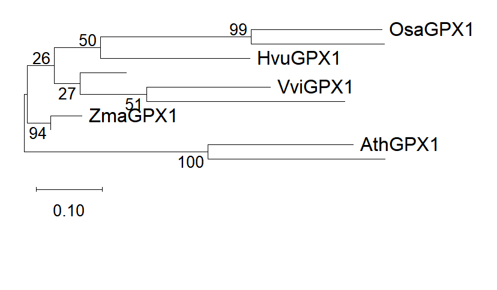

# Plant GPX1 Phylogeny

I used MEGA12 to explore plant GPX1 protein relationships with Neighbor-Joining (NJ) and Maximum Likelihood (ML) methods. This section preserves four tree images from my coursework and explains what can still be checked from the archived evidence.

The original MEGA ML caption records **10 amino-acid sequences, 245 alignment positions, the JTT model, and 500 bootstrap replicates**. Five species names are visible in each exported figure, but some terminal labels are missing. I therefore treat the images as an archive of the analysis, with limited biological interpretation until the full sequence manifest and tree files are recovered.

The ML original tree contains low-support internal branches (including 26 and 27). Some high support labels are next to a named and an unnamed terminal pair. They should not be reassigned to a different pair of named species.

See [methods and figure captions](methods-and-results.md) for all four images, the corrected interpretation, and the failed Galaxy IQ-TREE attempt.
