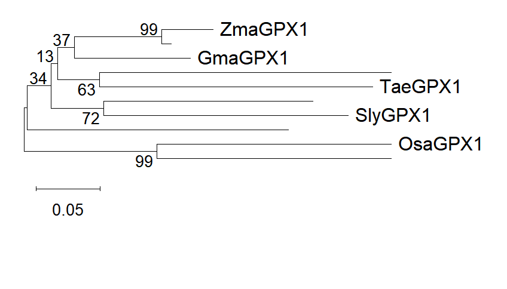
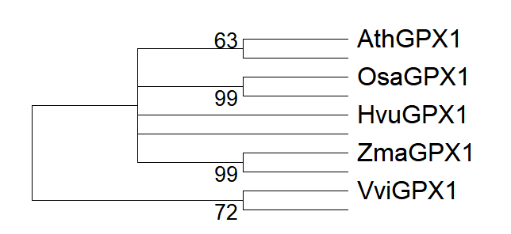
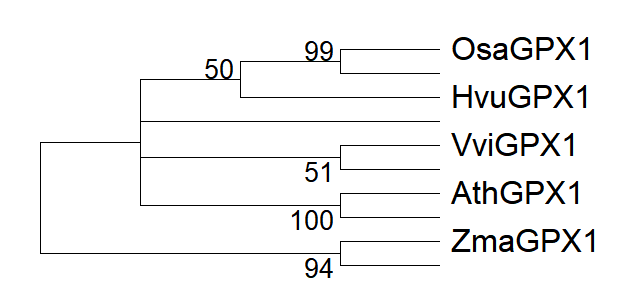

# Methods and Archived Tree Figures

## Question and Data

I explored plant glutathione peroxidase 1 (GPX1) homologs as a protein-sequence analysis exercise. My coursework records an Arabidopsis GPX1 query (UniProt P52032) and homolog searches with NCBI BLASTp, followed by alignment and tree construction in MEGA12.

The report describes two sets of five species names. However, the original MEGA-generated ML caption explicitly states **10 amino-acid sequences** and **245 positions** in the final alignment. The figures also show unlabeled tips. I have corrected the earlier shorthand of "five sequences": five displayed species labels do not establish that only five sequences were analyzed. Accession-level identities for all ten tips are not retained in this public archive.

| Displayed label | Species name recorded in the coursework |
|---|---|
| AthGPX1 | Arabidopsis thaliana |
| OsaGPX1 | Oryza sativa |
| HvuGPX1 | Hordeum vulgare |
| ZmaGPX1 | Zea mays |
| VviGPX1 | Vitis vinifera |
| GmaGPX1 | Glycine max |
| TaeGPX1 | Triticum aestivum |
| SlyGPX1 | Solanum lycopersicum |

These labels are the coursework's labels, not independently verified orthology assignments.

## Analysis Settings

| Method | Retained evidence |
|---|---|
| Neighbor-Joining | MEGA12; amino-acid analysis; Poisson correction and 500 bootstrap replicates reported in the coursework. Full final run settings are not retained. |
| Maximum Likelihood | MEGA12; JTT amino-acid substitution model; 500 replicates; 10 sequences; 245 positions; best displayed log likelihood -2498.63. These values are visible in the MEGA-generated caption. |
| ML consensus | A separate Bootstrap Consensus Tree view is retained. It summarizes support across resampled alignments. |
| Galaxy IQ-TREE | Version 2.4.0 and 1,000 bootstrap replicates were reported as intended settings. The job failed and produced no usable tree for comparison. |

NJ builds a tree from sequence distances. ML evaluates trees under a substitution model. Bootstrap support records how frequently a split is recovered after resampling alignment columns. It is not the probability that a species relationship is true, and a fixed support cutoff does not guarantee correctness. The original tree scale bars represent substitutions per site, not an average substitution rate for the whole alignment. See the [MEGA documentation](https://www.megasoftware.net/web_help_12/Analysis_Preferences_Maximum_Likelihood.htm).

## Figure 1: NJ, Species Set 1

The visible labels are ZmaGPX1, GmaGPX1, TaeGPX1, SlyGPX1, and OsaGPX1. Several additional tips have no visible label. The 99 near ZmaGPX1 belongs to a split involving an unlabeled tip; it is not sufficient evidence for the earlier prose claim that maize and soybean form a 99-supported pair. Scale bar: 0.05 substitutions per site.

## Figure 2: NJ, Species Set 2

The visible labels are AthGPX1, OsaGPX1, HvuGPX1, ZmaGPX1, and VviGPX1. This archived view lacks a distance scale and contains unlabeled tips. I retain the original pixels without inferring missing identities or asserting a named-species clade from the displayed 99 labels.

## Figure 3: ML Original Tree

This view matches the MEGA caption reporting the JTT model, 500 bootstrap replicates, 10 sequences and 245 sites. Internal values such as 26 and 27 indicate weak support for those splits. The 99 next to OsaGPX1 labels its pair with an unnamed tip; the broader branch containing the displayed HvuGPX1 label is marked 50. The original report's "rice-barley clade with 99% support" is therefore not supported by this image. Scale bar: 0.10 substitutions per site.

## Figure 4: ML Bootstrap Consensus Tree

This second view summarizes the bootstrap results. The branch arrangement is less resolved than the original tree. Its horizontal lengths should not be read as evolutionary distances because no distance scale is provided in this view.

## Interpretation and Next Steps

The exercise let me compare distance-based and model-based tree inference and practice reading support values. The archive supports a discussion of uncertainty and of how incomplete tip labels can lead to a wrong interpretation. It does not justify a definitive species tree, proof of GPX1 functional conservation, or a claim that ML always gives the correct topology.

For a reproducible extension, I would recover accession identifiers and the aligned FASTA/MEGA file, assign a unique label to every tip, check homolog/ortholog selection, document alignment trimming and model choice, and export Newick trees with all support values. The failed Galaxy IQ-TREE run would then be rerun with a validated alignment. Its failure cause cannot be established from the retained screenshot alone.
